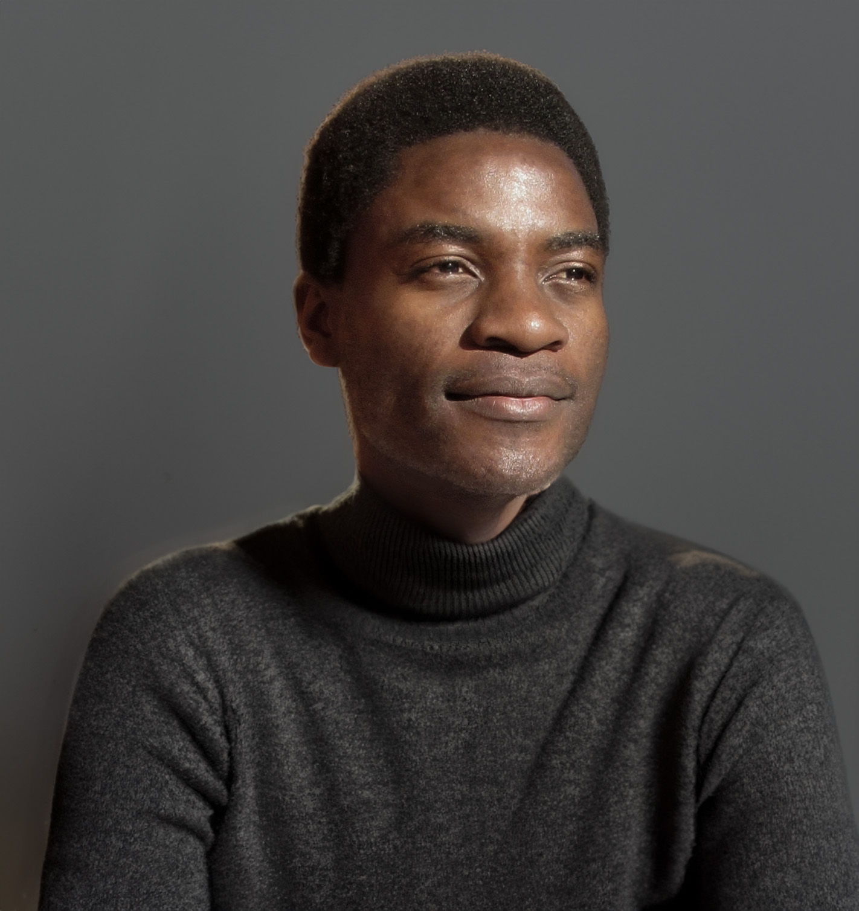

[ Joram Mutenge](../../)

October 28, 2026

# An age of amazing abundance

AI may be humanity’s most consequential invention yet. It could also be the last invention we need to make ourselves, if it becomes capable of accelerating the invention of everything that follows. We live in interesting times, and there are two ways this could go. One is catastrophic destruction, and the other is a life of amazing abundance. The first possibility has already been discussed at length on the news and in podcasts, so I’ll focus on the latter.

Imagine a life where hunger and poverty are things of the past. A life where the poverty-stricken, emaciated African children featured in NGO fundraising campaigns are seen only in museums because those days are long gone. A life where every human being, in every corner of the world, has everything they need. You might think such a life belongs in the distant future, but I’d argue that it’s closer than we think. And the instrument that could get us there is AI.

When we were hunter-gatherers, physical strength was one of the most important traits a person could have. Survival depended on it. But as humans became more civilized and invented machines capable of physical labor, intelligence became increasingly important. The modern economy runs on intelligence, and many people make a living as knowledge workers. But now, we have something that can do much of the thinking for us: AI. If physical strength was once essential for survival, and intelligence later became the most valuable human resource, what happens when machines can do both the physical work and the thinking for us?

AI can already perform some of the computer-based tasks that many people do for a living. It may eventually be capable of doing most of them. Meanwhile, advances in robotics could allow machines to take over much of the physical work that humans do today. If these technologies continue to improve, we could reach a point where working to make a living becomes unnecessary. That doesn’t necessarily mean all work will disappear. It means we might no longer have to work simply to afford food, housing, healthcare, and other necessities.

This is where the idea of an age of amazing abundance becomes interesting. AI and robots could dramatically increase our productivity, allowing us to produce more goods and services with less human labor. Elon Musk has talked about a future of universal high income (UHI), as opposed to universal basic income (UBI). The idea is that, in a world where machines can produce so much, people could enjoy a standard of living far beyond what a basic income would provide. After all, if there is plenty to go around, why limit ourselves to basic income?

Of course, there is a catch. Just because we can produce enough for everyone doesn’t mean everyone will automatically get their share. If a handful of companies own the AI systems, robots, factories, and other infrastructure responsible for producing this abundance, they could capture most of the wealth generated. We could end up in a world where machines can meet everyone’s needs, yet many people still struggle to afford the things they need. The problem would no longer be our inability to produce enough, but how we distribute what we produce.

This is an important distinction because technology alone cannot guarantee a life of abundance. We would need economic and political systems that allow ordinary people to benefit from the productivity of AI. Governments might tax the wealth generated by automation, people might own shares in the systems doing the work, or societies might find other ways to distribute the benefits. Whatever the solution, an age of amazing abundance will require more than intelligent machines. It will require us to figure out what to do with the wealth those machines create.

If we can get that right, living in an age of amazing abundance could be wonderful for most people, especially those living in poor countries. If you had presented this world to me as I was growing up in the slums of Lusaka, going to school on an empty stomach, I would have welcomed it with open arms. A world where nobody has to go to bed hungry, where everyone has access to quality healthcare, and where a child’s future isn’t determined by the circumstances of their birth would be a remarkable achievement. For someone who has experienced scarcity, the prospect of never having to worry about basic needs is difficult to overstate.

But for people in rich countries, who already enjoy a degree of material abundance, this future could present a different kind of challenge. What happens when the things that give people their identity disappear? Where would an investment banker find purpose if their profession no longer existed? What would happen to someone whose entire life revolved around climbing the corporate ladder, earning more money, and accumulating wealth? If AI can do their job better than they can, and they no longer need the money anyway, what would they do with their lives?

These questions might seem trivial compared with the problems of hunger and poverty, but I don’t think they are. Once we no longer have to worry about survival, we will have to figure out what makes life worth living beyond survival itself.

Money drives much of what human beings do today. We like to tell ourselves that we would continue making art, creating music, or venturing into entrepreneurship simply because we love doing those things. And to some extent, that’s true. People create things for the joy of creating them. They play sports without being paid, write stories that nobody reads, and pursue hobbies that will never make them rich. But money is also a powerful motivator. It gives people a reason to endure the tedious, difficult, and sometimes unpleasant parts of their work. A musician might love making music, but that doesn’t mean they enjoy every hour spent rehearsing, recording, promoting, and performing.

If making a living were no longer necessary, some people would probably continue doing what they love. Others might not. We cannot assume that the disappearance of financial incentives would eliminate human creativity, but neither can we assume that people would continue working with the same intensity and commitment when their livelihoods no longer depended on it.

Imagine an aspiring musician who spends ten years learning an instrument, writing songs, and performing in small venues. Today, the possibility of making a living from music might give them the incentive to keep going. In an age of abundance, they could pursue music simply because they enjoy it, but they could also decide that their time is better spent doing something else. Perhaps they would spend more time with their family, travel, or take up a different hobby. None of these choices would be wrong. But if enough people made similar decisions, some of the things we enjoy today might become less common.

This is why I think an age of amazing abundance could also be a world full of lost people. Not because everyone would become lazy or lose the ability to do meaningful things, but because we have built much of our lives around the need to earn a living. Work gives us structure, social relationships, recognition, and a sense of accomplishment. For many people, their job is more than a source of income. It is part of who they are. Take that away, and what replaces it?

Perhaps we would find new sources of purpose. People might devote themselves to their families, scientific discovery, art, sports, community service, or simply learning about the world. We might discover that we have been so busy making a living that we have neglected the things that make life worth living. That would be a wonderful outcome. But I don’t think it would happen automatically. We would have to learn how to live in a world where survival no longer dictates how we spend our time.

There is also the question of status. Even if everyone had enough money to live comfortably, would we stop competing with one another? I doubt it. Human beings don’t just want to survive. We want to feel important, to be admired, and to have something that sets us apart from everyone else. Today, wealth is one of the ways we achieve that. If everyone had access to the same material comforts, we might simply find something else to compete over. Perhaps it would be fame, influence, artistic achievement, or the number of people who admire us. An age of abundance might eliminate some forms of inequality without eliminating our desire to be better off than other people.

Alain de Botton once made a point about how a rich country like Switzerland might face problems that a country like Zimbabwe would encounter much later in its development. The implication is that as societies become wealthier, the problems they face can change. When people no longer have to worry as much about material needs, other concerns become more prominent. I wonder whether AI could accelerate that process, bringing some of the problems associated with wealthy societies to countries that are still struggling with poverty. If hunger and poverty become relics of the past, we might find ourselves dealing with problems of purpose, identity, loneliness, and fulfillment on a much larger scale.

Of course, not every problem can be solved by making things cheaper or giving people more money. A country can become wealthier without eliminating loneliness or depression, just as a person can have everything they need and still feel unhappy. But if AI really does make material abundance possible, it could force us to confront a question that many people have never had the luxury of asking: What do we live for when we no longer have to spend our lives trying to survive?

I enjoy watching TV shows and movies, and when I imagine this world of amazing abundance, I picture myself spending all day watching them. I could watch whatever I wanted, whenever I wanted, without worrying about the cost. But then it dawned on me that the actors in those shows and movies are working to produce the entertainment I enjoy. The writers, directors, cinematographers, editors, and countless other people involved in making a film are also doing work that takes time, skill, and effort. They do it for a living, even if they also love what they do.

If those people no longer needed to work to make a living, would they continue making the shows and movies I enjoy? Some undoubtedly would. Others might decide to do something else with their time. And if enough people stopped making films, there might be fewer new human-made shows and movies for me to watch.

“But Joram, AI will make those movies and shows for you. All you need is a prompt telling AI what movie you want, and it will make it just for you.”

That’s a fair point. AI could eventually produce an almost unlimited supply of entertainment, tailored to each person’s tastes. I could ask for a detective series set in Lusaka, starring my favorite actors, with exactly the kind of plot I enjoy. I wouldn’t have to wait for a studio to greenlight the project or for a production team to spend years bringing it to life. The movie would simply appear.

But would I enjoy it as much?

I don’t know. Perhaps AI-generated movies will become so good that I won’t care whether the people on screen are real. Perhaps I’ll find stories and performances that move me just as much as anything made by human beings. But I suspect that knowing a real person has brought a character to life is part of what makes a performance meaningful to me. There’s something interesting about watching an actor draw on their own experiences, emotions, and understanding of the world to portray someone else. Even if AI can imitate the result perfectly, I wonder whether knowing that no human being actually performed the role would change how I experience it.

Would I want to watch an AI version of Rachel Stirling or Laura Benanti? For now, the answer is a big NO.

Maybe I’ll change my mind. Maybe the next generation will grow up watching AI-generated movies and won’t understand what the fuss is about. But I think this question goes beyond entertainment. If AI can produce almost anything we want, will we still value the things that come from human effort, experience, and creativity? Or will we eventually stop caring about how something was made, as long as it gives us what we want?

I would love to live in an age of amazing abundance. I would love to see a world where no child goes to school hungry, where nobody is denied healthcare because they cannot afford it, and where people are free to spend their lives doing things they find meaningful rather than doing whatever pays the bills. For someone who grew up experiencing scarcity, that future is difficult not to welcome.

But I also wonder whether we are prepared for it. We’ve spent centuries building economies, institutions, and identities around the idea that people must work to earn a living. If AI makes that arrangement unnecessary, we will have to rethink more than how we make money. We will have to rethink how we find purpose, how we measure success, and what we value in one another.

Perhaps an age of amazing abundance will turn out to be the greatest thing that has ever happened to humanity. Perhaps it will free us to live fuller, more meaningful lives. But abundance alone cannot guarantee that outcome. We might solve the problem of producing enough for everyone and still struggle to figure out what to do with our lives.

After all, what happens when humanity solves the problem of survival but hasn’t yet solved the problem of living?
