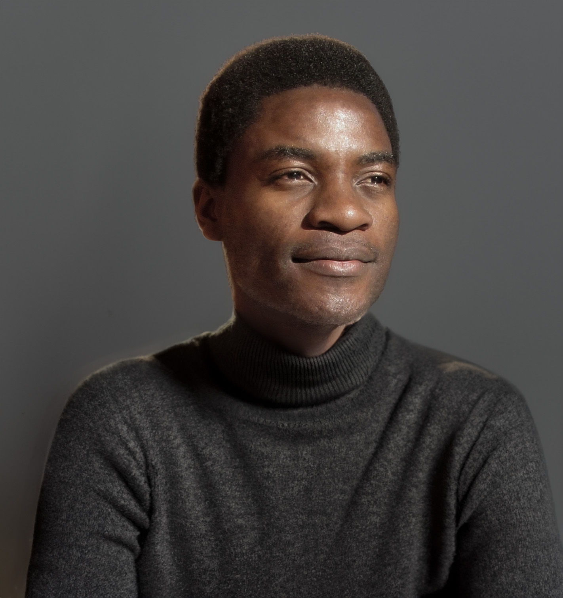

[ Joram Mutenge](../../)

November 11, 2026

# Shopping for permission

Yesterday, I was listening to the *Modern Wisdom* podcast, particularly the episode in which Shaan Puri talked about the nine harsh truths no one wants to admit. One of them hit me like a brick in the head. Shaan said that most people who ask for advice are not really seeking advice. What they are seeking is permission. When you ask for advice, you often already know what to do. All you want is for another person to confirm what you already want to do. So, you hide behind the guise of seeking advice when what you’re really shopping for is permission.

Hearing that made me feel guilty. Why? Because it was the truth. That’s exactly what I’ve been doing. I’ve never said this publicly, but I need to come clean. For a long time, I’ve wanted to have a podcast where I interview people. One of the greatest joys in my life is having conversations with people. I love swapping stories, debating ideas, and engaging in good old banter. Yet, I never started an interview podcast. I do, however, have a solo podcast that I started way back in 2020. In it, I talk about interesting things that make my country what it is. The podcast is called *50 Things That Define Zambia*. Now that it has only one episode remaining before it comes to an end, I really need to start a podcast that allows me to interview people.

So, why did I feel guilty when I heard that harsh truth from Shaan? Here’s some background information to help you understand. First, you should know that I’m an avid podcast listener. I listen to many podcasts covering a wide range of topics. In my quest to become the host of an interview podcast, I first reached out to Ken Jee, host of *Ken’s Nearest Neighbors*. As a data professional, I listened to this podcast religiously. When I noticed that Ken had put it on hiatus for a long time and had started a new podcast, I reached out to him in March 2025 and asked if I could take over as the new host of *Ken’s Nearest Neighbors*. Surprisingly, he replied that same day. He said he hadn’t abandoned the project and added that he would be uploading new episodes in about three to five months.

As a loyal listener, I continued checking Ken’s podcast feed, but no new episodes appeared. So, in November 2025, I contacted him again, asking him to take the project off his plate and allow me to become the new host. This time, there was no reply. Then, in April 2026, I reached out once more, practically begging him to let me take over. Still, nothing. Finally, in September 2026, I sent my last message, pleading with Ken to hand me the keys to his seemingly abandoned podcast. He never replied, and he hasn’t uploaded a new episode since October 2024.

Daliana Liu was another person in the data community I reached out to. I’d just listened to an episode of her podcast, *The Data Scientist Show*, in which she announced that she would be ending the show. Naturally, I contacted her and asked if she would let me take over as host. That was in April 2025. I even provided a recording to demonstrate how serious I was. You can [listen to it](https://www.conterval.com/blog/data-scientist-show/). Like Ken, Daliana didn’t take me up on my offer. Instead, she said she would rebrand the podcast and carry on hosting.

Still enthusiastic about hosting a data podcast, I decided to change gears. I began to realise that people who already had podcasts weren’t particularly interested in handing them over. Perhaps I needed to target people who didn’t already have one. That’s when I reached out to Christine Payton. She’s a data YouTuber, and I thought I’d float the idea of starting a podcast together so we could co-host it. I sent her a message in June 2026 explaining the idea, but I haven’t heard anything from her since. Around the same time, I also reached out to Matt Harrison, another person in the data community, pitching the idea of starting a podcast together. That was also in June 2026. To this day, I haven’t heard anything from him either.

By this point, I should have learned that reaching out to other people wasn’t working. Somehow, though, that wasn’t obvious to me. More recently, I came across a LinkedIn post announcing that two data personalities I follow, Tristan Handy and Ben Stancil, were starting a new podcast called *Partially Committed* with another co-host. I listened to their first episode and immediately thought, I need to be part of this project! So, I reached out to Ben, who was already a connection on LinkedIn, and asked him to pass along a message to Tristan expressing my interest in joining the project. Of course, I didn’t say I wanted to be a co-host. These guys are big names in the data community, while I’m practically a nobody. Instead, I offered to help edit the episodes so they could focus on the discussions.

I sent that message less than a week ago. When I didn’t hear back from Ben, I decided to try a different approach. I commented on Tristan’s LinkedIn post, expressing my interest in joining them on this journey as the person responsible for editing the episodes. Sadly, I haven’t heard anything from either of them.

Which brings me back to Shaan’s harsh truth. I felt guilty because, if I’m being honest with myself, I was scared to start a podcast on my own. I wanted to take over an established podcast because it felt like a safer bet. I wanted to start one with a well-known person for exactly the same reason. Much like someone who is afraid to act on their own plans and instead seeks advice in the hope that another person will validate those plans and give them the green light, I was afraid to start a podcast by myself. Rather than take the plunge, I kept reaching out to all these people, hoping one of them would open the gate for me. But the truth is, the gate isn’t locked. I can open it myself and find my place in the podcasting world.

That’s why I’m announcing the launch of my new podcast, *Origin Episode*. It will finally allow me to do something I’ve wanted to do for a long time: interview people. I’ve stopped begging other podcasters to hand me the keys to their podcast castles. Instead, I’m building my own. You can [learn more about Origin Episode here](https://www.originepisode.com/about). I’m also looking for guests, so if you’d like to be part of the journey, [fill out this form](https://www.originepisode.com/share) to become my next guest.
